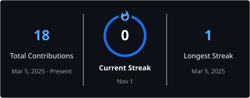

  

  <a href="#about-me">About</a> ·
  <a href="#featured-work">Featured Work</a> ·
  <a href="#tech-stack">Tech Stack</a> ·
  <a href="#github-analytics">GitHub Analytics</a>

## About Me

I'm **Sean Ooi**, a developer interested in **Generative AI, natural language processing, data analytics, and AI agents**. I build applications that turn complex information into useful tools, from citation-grounded news search and speech-enabled NLP to operations workflows and personal finance.

My work spans model experimentation, data pipelines, backend services, and web and mobile interfaces. I value clear evaluation, traceable outputs, and human review in AI-assisted workflows.

- **Generative AI & agents:** retrieval-augmented generation, tool calling, and workflows with explicit approval.
- **NLP & speech:** information retrieval, text classification, multilingual processing, and speech-to-text.
- **Data analytics & machine learning:** exploratory analysis, visualization, computer vision, and reinforcement learning.

## Featured Work

| Project | What it does |
| --- | --- |
| **[MedVoice Assist](https://github.com/sean8911/medvoice-assist)** |Speech-enabled NLP research prototype combining Whisper transcription, symptom extraction, a trained BioBERT classifier, and rule-based responses. Research use only. **Stack:** React · FastAPI · PyTorch · Transformers · Whisper |
| **[NewsLens AI](https://github.com/sean8911/NewsLens-AI)** |News intelligence application with RSS ingestion, hybrid keyword/vector search, citation-grounded chat, event timelines, and publisher comparisons. **Stack:** Next.js · TypeScript · FastAPI · PostgreSQL · Qdrant |
| **[MakerOps AI](https://github.com/sean8911/makerops-ai)** |Operations assistant for 3D-printing workshops, connecting inventory, printer capacity, deterministic quotations, and LangGraph workflows with human approval. **Stack:** React · TypeScript · FastAPI · LangGraph · PostgreSQL |
| **[BakiBuddy](https://github.com/sean8911/bakibuddy)** |Personal finance development preview for Malaysian students and young adults, with local budgeting, spending insights, reviewed imports, OCR, and an optional consent-based AI assistant. **Stack:** React Native · Expo · TypeScript · SQLite · Groq |
| **[Banking Analytics](https://github.com/sean8911/banking-app)** |Interactive analytics application for exploring campaign data through PCA and clustering, alongside customer-service text themes using NMF. **Stack:** JavaScript · Plotly.js · HTML · CSS |
| **[Skin Lesion Classification](https://github.com/sean8911/skin-lesion-classification)** |Compares custom CNNs with KAN–Vision Transformer hybrids for multi-class skin lesion classification, with training analysis and attention visualizations. **Stack:** PyTorch · timm · scikit-learn · OpenCV |
| **[dPickleBall RL Agent](https://github.com/sean8911/dpickleball-rl-agent)** |PPO agent developed through a calibrated simulator, curriculum learning, Unity fine-tuning, and self-play. Placed third among thirteen competition groups. **Stack:** PyTorch · Stable-Baselines3 · Gymnasium · OpenCV |
| **[Aerial Pineapple Detection](https://github.com/sean8911/aerial_pineapple_drone)** |Drone-imagery pipeline that tiles georeferenced orthomosaics, detects and counts pineapple plants, and exports mapped detections as shapefiles. **Stack:** YOLOv10 · Ultralytics · Rasterio · GeoPandas |

[Explore all repositories →](https://github.com/sean8911?tab=repositories)

## Tech Stack

### Languages

### AI, NLP & Agents

Computer vision and reinforcement learning: **OpenCV · Ultralytics / YOLO · timm · Stable-Baselines3 · Gymnasium**.

### Web & Mobile

### Data & Backend

Data visualization and geospatial analysis: **Matplotlib · Seaborn · GeoPandas · Rasterio**. API validation and migrations: **Pydantic · Alembic**.

### Development & Quality

## GitHub Analytics

  
  

  

*Statistics and language cards refresh daily from public GitHub data. Language distribution reflects repository code, including notebooks, rather than proficiency.*

### Contribution Activity

  <picture>
    <source media="(prefers-color-scheme: dark)" srcset="https://raw.githubusercontent.com/sean8911/sean8911/output/github-snake-dark.svg">
    
  </picture>

---

Interested in practical AI, NLP, or data-driven applications? Explore the projects above to see the implementation, experiments, and documentation behind the work.
